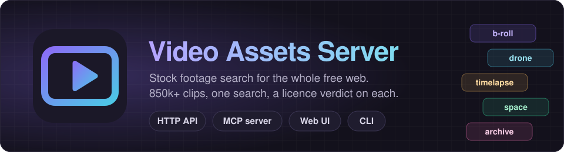
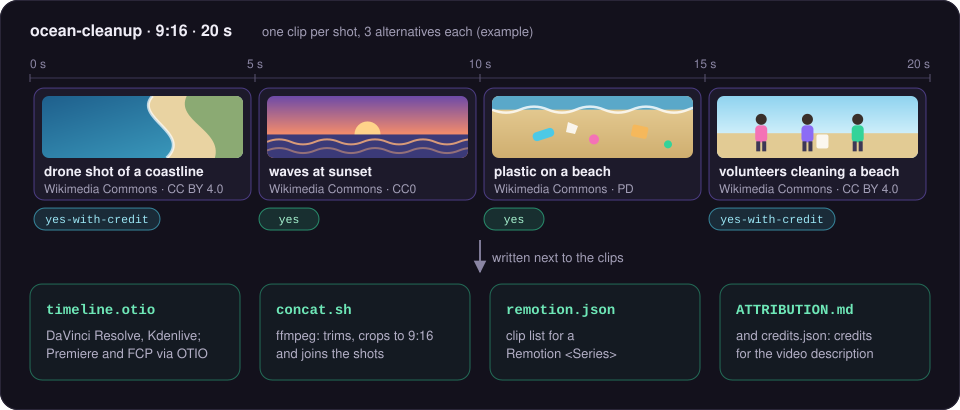
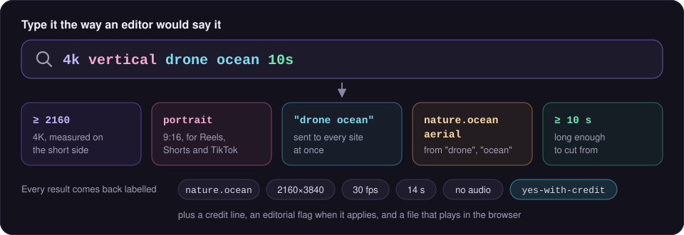
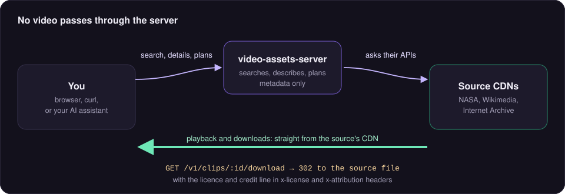
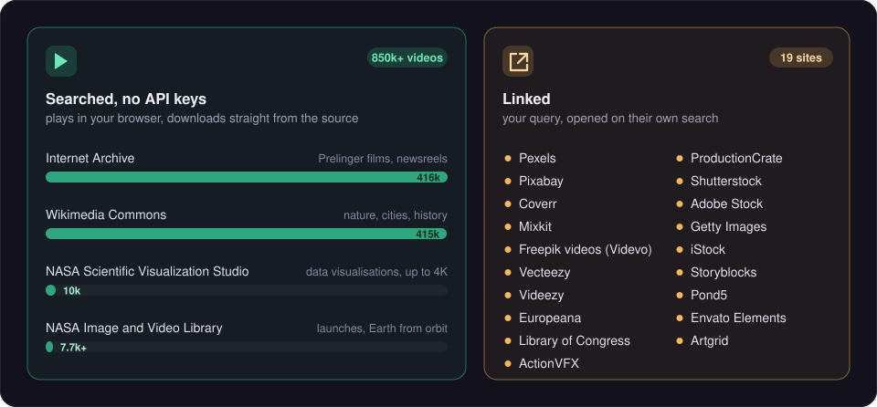
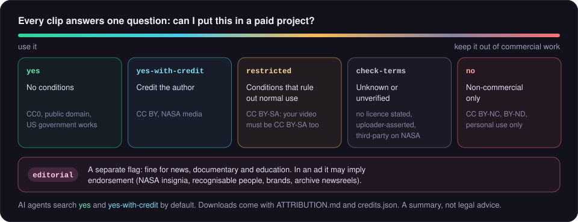
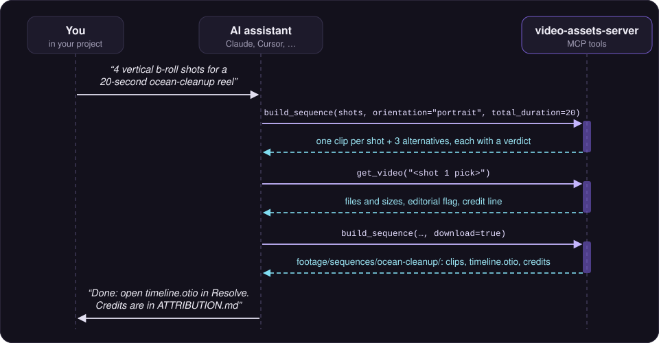

<p align="center">
  
</p>

**Stock footage search for the whole free web.** video-assets-server searches NASA, Wikimedia Commons
and the Internet Archive at once (850k+ videos, no API keys) and links you to 19 more stock sites:
b-roll, nature, cities, aerials, space, science, backgrounds, overlays, green screen and archive
films. Every clip tells you whether you can use it commercially. Watch clips in the browser, download
them, or let your AI assistant cut a b-roll sequence for your video.

> *"Find 4 vertical b-roll shots for a 20-second ocean-cleanup reel."*
>
> Your assistant calls `build_sequence`, gets one clip per shot with alternatives and their licences,
> and writes an OpenTimelineIO timeline, an ffmpeg script, a Remotion composition and the credits
> into your project.



- **One query, many sources.** Results are merged, de-duplicated and ranked, with a status line for every site.
- **Video-aware search.** "4k vertical drone ocean 10s" becomes resolution, orientation and duration
  filters. Every result has a category (`nature.ocean`, `city.street`, `space.earth`…), styles
  (timelapse, slow motion, loop…), and resolution, frame rate, length and audio when known.
- **Licence first.** Every result carries a **verdict for commercial use**: `yes`, `yes-with-credit`,
  `restricted`, `check-terms` or `no`, an **editorial** flag for news and archive footage, and a
  ready-to-paste credit line. Downloads come with `ATTRIBUTION.md` and `credits.json`.
- **No video passes through the server.** Clips play in your browser straight from the source's CDN,
  and downloads are redirects to the source file. The server only searches, describes and plans.
- **Honest about what's blocked.** Sites that need an API key or forbid automated access come back as
  links to their own search, so you still know where else to look.

Live at **<https://video.shep.bot>** (free, non-commercial). Planning notes and research:
[docs/PLAN.md](docs/PLAN.md), [docs/research/](docs/research/).

---

## Contents

- [How it works](#how-it-works)
- [Sources](#sources)
- [Licence verdicts](#licence-verdicts)
- [Quick start](#quick-start)
- [MCP: use it from an AI assistant](#mcp-use-it-from-an-ai-assistant)
- [HTTP API](#http-api)
- [CLI](#cli)
- [Downloads and sequences](#downloads-and-sequences)
- [Configuration](#configuration)
- [Deploying](#deploying)
- [Project layout](#project-layout)
- [Development](#development)
- [Etiquette](#etiquette)

---

## How it works



Every site is searched in parallel with its own timeout. A slow or blocked site never fails the
search: it shows up in the per-site report, with a link to the same search on that site.



---

## Sources



**Searched (4), no API keys needed**

| Source | Best for | Downloads | Licence |
|---|---|---|---|
| [NASA Image and Video Library](https://images.nasa.gov) | Launches, Earth from orbit, astronauts, missions | originals and 1080/720/360p renditions | NASA media guidelines: free with credit, **editorial** (no implied endorsement); third-party footage (SpaceX, ESA…) is `check-terms` |
| [NASA Scientific Visualization Studio](https://svs.gsfc.nasa.gov) | Data visualisations, Sun, Earth, planets, up to 4K/60 | every rendition on the page | NASA media guidelines, free with credit |
| [Wikimedia Commons](https://commons.wikimedia.org) | Everything: nature, cities, animation, history | WebM/Ogg originals and transcodes | per file: CC0 / PD / CC BY / CC BY-SA |
| [Internet Archive](https://archive.org) | Prelinger archive films, newsreels, public-domain movies | yes | uploader-asserted, capped at `check-terms` (Prelinger is trusted); archive footage is **editorial** |

**Linked (19, deep link to the site's own search):** Pexels, Pixabay, Coverr, Mixkit, Freepik videos
(Videvo), Vecteezy, Videezy, Europeana, Library of Congress, ActionVFX, ProductionCrate (FootageCrate),
Shutterstock, Adobe Stock, Getty Images, iStock, Storyblocks, Pond5, Envato Elements, Artgrid.
These need an API key we don't have yet (Pexels, Pixabay), block bots, or their robots.txt or
terms forbid automated access.

`GET /v1/providers` (or `list_sources` over MCP) lists every source with its access method and licence.
[integrations/registry.json](integrations/registry.json) records every site that was considered,
including the rejected ones and why.

## Licence verdicts



| Verdict | Means | Examples |
|---|---|---|
| `yes` | Usable commercially, no conditions | CC0, public domain, US government works |
| `yes-with-credit` | Usable if you credit the author | CC BY, NASA media |
| `restricted` | Conditions that usually rule out normal use | CC BY-SA (your video must be CC BY-SA too) |
| `check-terms` | Unknown or unverified | no licence stated, uploader-asserted, third-party footage on NASA |
| `no` | Non-commercial only | CC BY-NC, CC BY-ND, personal use only |

**Editorial** is a separate flag: the footage is fine for news, documentary and education, but
showing it in an ad may imply endorsement (NASA insignia, recognisable people, brands, archive
newsreels). Credits files list editorial clips in their own section.

Verdicts are a summary, not legal advice. AI agents search commercial-safe clips by default.
See [/docs/licences](https://video.shep.bot/docs/licences).

## Quick start

Needs Node.js 22 or newer. ffmpeg is only needed to render the scripts `build_sequence` writes.

```bash
git clone https://github.com/arielshad/video-assets-server.git
cd video-assets-server
npm install && npm --prefix web install
npm run build

npm start                                   # web UI + HTTP API + MCP on http://localhost:8787
node dist/cli.js mcp                        # MCP over stdio
node dist/cli.js search "4k drone ocean" --commercial
```

With Docker:

```bash
docker run -p 8787:8787 ghcr.io/arielshad/video-assets-server
```

## MCP: use it from an AI assistant



```bash
# Hosted
claude mcp add --transport http video https://video.shep.bot/mcp

# Local (can write files into your project)
claude mcp add video -e VIDEO_DOWNLOAD_DIR="$PWD/footage" -- node /path/to/video-assets-server/dist/cli.js mcp
```

| Tool | What it does |
|---|---|
| `search_videos` | Search every source; resolution, orientation, length and fps words become filters; commercial-safe by default |
| `get_video` | Licence, editorial flag, credit line, every file with its size, and the file that plays in a browser |
| `build_sequence` | A shot list in, one clip per shot with alternatives out, plus OTIO, an ffmpeg script, a Remotion composition and credits |
| `download_video` | Local only: files the clip by category at the resolution you ask for and updates ATTRIBUTION.md / credits.json |
| `list_sources` | Every source and what it is good for |

## HTTP API

```bash
curl "https://video.shep.bot/v1/search?q=ocean+waves&orientation=portrait&min_resolution=1080&commercial=true"
curl "https://video.shep.bot/v1/search?q=timelapse+city+night&max_duration=20"
curl "https://video.shep.bot/v1/clips/nasa:GSFC_20160909_M12368_OSIRIS_launch"           # details + `watch` file
curl -L -o clip.mp4 "https://video.shep.bot/v1/clips/<id>/download?height=1080"   # 302 to the source
curl -o credits.zip "https://video.shep.bot/v1/clips/<id>/credits?format=zip"     # ATTRIBUTION.md + credits.json
curl -X POST https://video.shep.bot/v1/sequences -H 'content-type: application/json' \
  -d '{"shots":["drone shot of a coastline","waves at sunset","plastic on a beach"],"orientation":"portrait","totalDuration":20}'
```

Search parameters: `q`, `category` (comma list; a parent like `nature` matches its children), `style`,
`orientation` (`landscape`, `portrait`, `square`), `min_resolution` (`720`, `1080`, `1440`, `2160`, `4k`),
`min_duration`, `max_duration`, `min_fps`, `audio`, `commercial`, `free`, `downloadable`, `strict`,
`providers`, `limit`, `offset`.

Other routes: `/v1/clips/:id/files` (`height`, `format`, `role`, `all`), `/v1/providers`, `/v1/catalog`,
`/v1/stats`, `/openapi.json`. Full reference: [/docs/api/reference](https://video.shep.bot/docs/api/reference).

Downloads never stream through the server: `/download` answers with a 302 to the source file and
puts the licence and credit line in `x-license` and `x-attribution` headers. A clip that can only be
fetched with a login or special headers answers 409 with its source page.

## CLI

```bash
video-assets-server search "4k vertical drone ocean 10s"
video-assets-server search "rocket launch" --providers nasa --min-resolution 1080
video-assets-server download nasa:GSFC_20160909_M12368_OSIRIS_launch --height 1080 --dir ./footage
video-assets-server sequence "city at night; traffic timelapse; neon signs" --orientation portrait --total 15 --download
video-assets-server serve
video-assets-server mcp
```

## Downloads and sequences

- The file picker takes the smallest file at or above the resolution you ask for (by short side, so
  1080 means 1080p in landscape or portrait), prefers MP4 between files of the same size, and never picks a file that needs a login.
  Without a height it takes the original.
- Local downloads go to `VIDEO_DOWNLOAD_DIR` (default `./footage`), filed by category
  (`footage/nature/ocean/…(1080p).mp4`). Every download merges its credits into `ATTRIBUTION.md` and
  `credits.json` in that folder.
- `build_sequence` searches once per shot, splits the total length across the shots and falls back to
  other orientations (with a crop note) when a shot finds nothing. Its exports:
  - `timeline.otio`: OpenTimelineIO JSON for DaVinci Resolve, Premiere (via adapters) or Kdenlive;
  - `concat.sh`: ffmpeg trims, scales/crops to the target size and joins the shots;
  - `remotion.json`: props for a Remotion `<Series>`;
  - `ATTRIBUTION.md` and `credits.json`.
  With `--download` (CLI) or `download=true` (local MCP), the clips are saved next to them and the
  scripts point at the local files.

## Configuration

| Variable | Default | Purpose |
|---|---|---|
| `PORT`, `HOST` | `8787`, `0.0.0.0` | HTTP listener |
| `VIDEO_SERVER_PUBLIC_URL` | request origin | Public base URL for links |
| `VIDEO_SERVER_USER_AGENT` | built in | User-Agent for source requests; include contact details (Wikimedia throttles anonymous clients) |
| `VIDEO_DOWNLOAD_DIR` | `./footage` | Where local downloads go |
| `VIDEO_SERVER_API_KEY` | none | Require a key on `/v1` and `/mcp` (header only) |
| `VIDEO_SERVER_PROVIDERS` | all | Comma list to enable a subset |
| `VIDEO_SERVER_HTTP_MCP` | `true` | `false` turns off MCP at `/mcp` |
| `VIDEO_SERVER_HTTP_DOWNLOADS` | `false` | Expose `download_video` on the HTTP MCP endpoint (writes to the server's disk) |
| `VIDEO_SERVER_RATE_LIMIT`, `VIDEO_SERVER_RATE_LIMIT_WINDOW` | `120`, `60` | Requests per client per window (seconds) on `/v1` and `/mcp` |
| `VIDEO_SERVER_MAX_DOWNLOAD_BYTES` | 8 GiB | Cap per local download |
| `VIDEO_SERVER_CACHE_TTL_MS`, `VIDEO_SERVER_HTTP_TIMEOUT_MS`, `VIDEO_SERVER_PROVIDER_TIMEOUT_MS` | built in | Source cache and timeouts |
| `METRICS_PORT`, `PROMETHEUS_URL` | off | Prometheus metrics and `/stats` |
| `MAXMIND_ACCOUNT_ID`, `MAXMIND_LICENSE_KEY`, `VIDEO_SERVER_ASN_DB` | none | Label MCP callers by network in metrics |
| `VIDEO_SERVER_SESSION_SECRET` | random | Signs MCP session IDs |
| `UMAMI_WEBSITE_ID`, `UMAMI_HOST` | none | Web page views to your Umami |
| `VIDEO_SERVER_TELEMETRY` | off | Opt-in anonymous install telemetry (needs `VIDEO_SERVER_TELEMETRY_WEBSITE_ID`); `DO_NOT_TRACK=1` always wins |

`node dist/cli.js help` lists everything.

## Deploying

The production setup mirrors sound-server and 3d-asset-server:

1. CI (`.github/workflows/ci.yml`) tests, builds `ghcr.io/arielshad/video-assets-server:{latest,sha-…}` on every
   push to `main`, and commits the new tag to `deploy/kustomization.yaml`.
2. ArgoCD syncs `deploy/` (kustomize) into the `video-assets-server` namespace. The app is registered in
   shep-ai/shep-infra (`bootstrap/apps/89-video-assets-server.yaml`).
3. `deploy/ingress.yaml` serves `video.shep.bot` behind the edge Caddy (on-demand TLS for `*.shep.bot`).
4. Prometheus scrapes the metrics port (`deploy/servicemonitor.yaml`); the Grafana dashboard
   "video-assets-server" and the Umami website for video.shep.bot live in shep-infra. Logs reach Loki
   through the cluster's Alloy with no per-app setup.
5. No secrets are needed: every searched source is keyless. An optional `video-assets-server-env`
   Secret can add `VIDEO_SERVER_API_KEY`, `VIDEO_SERVER_SESSION_SECRET` or the MaxMind keys (see the
   comment in `deploy/deployment.yaml`).

No PVC: the pod keeps only an in-memory cache, so rollouts are rolling updates.
Releases to npm (`npx video-assets-server`) run from version tags (`.github/workflows/release.yml`).

## Project layout

```
src/core/       model (types, vocab), classify, query parsing, licences, search service,
                downloads, sequences, credits, census, collections, analytics
src/providers/  one file per source; link.ts / linked.ts for deep-link-only sites
src/api/        Hono app: REST API, MCP over HTTP, website serving, OpenAPI, share cards
src/mcp/        MCP tools
web/            Astro website (search with in-browser playback, sequence builder, docs, collections)
scripts/        daily census, collection snapshots, quality gates
prompts/        instructions for the scheduled source-discovery and collection agents
deploy/         Kubernetes manifests (kustomize)
test/           offline tests with fixtures; test/live/ runs against the real sites (LIVE=1)
```

## Development

```bash
npm test                 # offline tests
npm run typecheck        # server + website
LIVE=1 npm run test:live # hits the real sites
npm run dev              # watch mode
```

New source? Read [docs/PROVIDERS_GUIDE.md](docs/PROVIDERS_GUIDE.md).

## Etiquette

At most a couple of requests per search, a descriptive User-Agent, short caches, robots.txt and terms
respected (a site that forbids automated access is link-only), and no mirroring or re-hosting of
anyone's footage. Report problems at <https://github.com/arielshad/video-assets-server/issues>.

Code: Apache-2.0. Footage belongs to its authors under their own licences.
